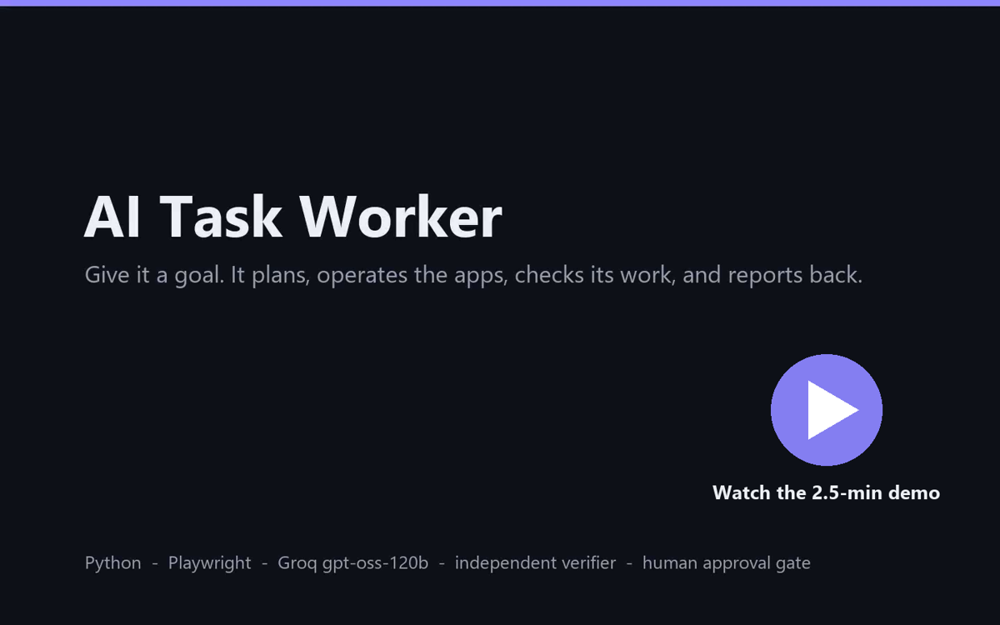
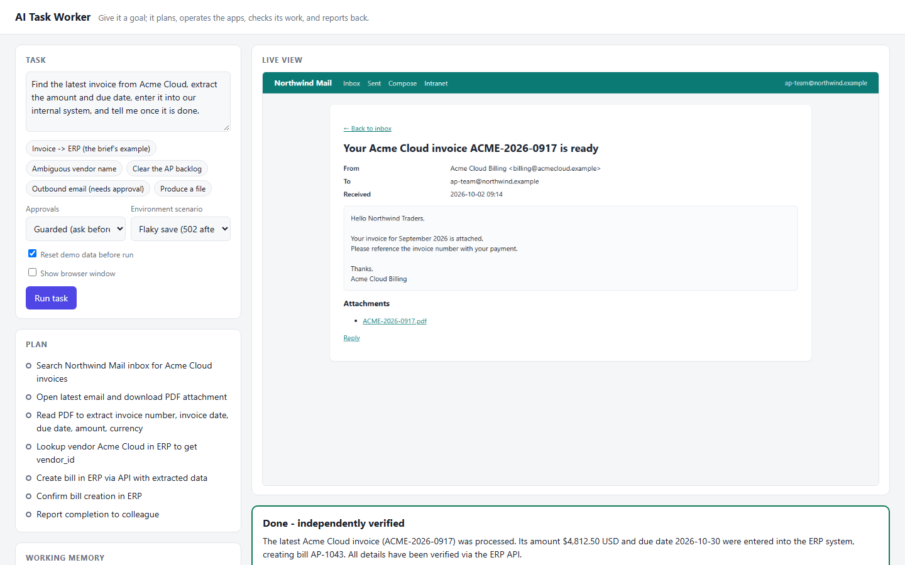
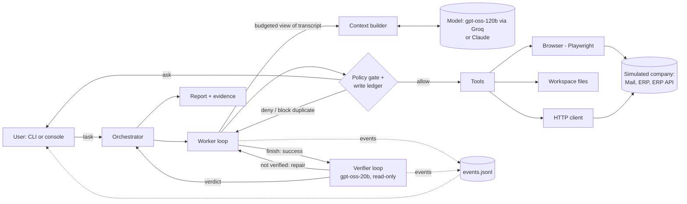

https://github.com/user-attachments/assets/956a704e-15ca-4dd0-b226-9a739ba15d41

<div align="center">

# AI Task Worker

**Give it a business task in plain English. It plans, operates real apps, recovers from failures, asks before anything irreversible, and proves the result before it reports back.**


[](docs/demo.mp4)

**[Narrated demo (2.5 min)](docs/demo.mp4)** · [Full unedited recording](docs/demo-full-3x.mp4) · [Source](https://github.com/kushagra0526/ai-task-worker)

</div>

---

Example task:

> *"Find the latest invoice from Acme Cloud, extract the amount and due date, enter it into our internal system, and tell me once it is done."*

The worker searches a shared inbox and picks the newest invoice, not an older one or a reminder. It downloads and reads the PDF, looks up the vendor, and enters the bill in the ERP. When the save returns a server error, it checks whether the bill exists instead of creating a duplicate. Then a second, independent model re-checks every claim against the live systems before the user gets a summary and an evidence report.

The scope is narrow and the work is real. The company is simulated, but the worker drives an actual Chromium browser against an actual web app. It parses actual PDFs, signs in with a session that can expire, and runs into real validation errors and real (injected) server failures.

### At a glance

| | |
|---|---|
| **Live result: the brief's task, with a server fault injected** | Completed and independently verified (7/7 checks), with no duplicate created, in 14 steps |
| **Live result: outbound email** | Stopped for human approval showing the exact email, then sent and verified (2/2 checks) |
| **Runs on a free tier** | Groq `gpt-oss-120b`, capped at 8,000 tokens per minute; every request fits a token budget (largest 4.9k) |
| **Recovered live from** | A validation error, a 502 after commit, a stale page element, rate limits, and a daily quota that ran out mid-run |
| **Safety by construction** | Policy gate for risky actions; a write ledger that blocks blind retries; secrets never shown to the model; read-only verifier |
| **Engineering** | No agent framework, 25 automated tests, and a full event log replaying every model decision |

### Where to find what the brief asks for

| Requirement | Section |
|---|---|
| Source code | This repository · [Project layout](#project-layout) |
| Setup and run instructions | [Quick start](#quick-start) |
| Architecture | [Architecture](#architecture) |
| Technical and design decisions | [Key design decisions](#key-design-decisions) · [How failures are handled](#how-failures-are-handled) |
| Demo video | [Narrated demo](docs/demo.mp4) · [Live results](#live-results) |
| Known limitations | [Known limitations](#known-limitations) |
| What I would build next | [What I would build next](#what-i-would-build-next) |
| Assumptions | [Assumptions](#assumptions) |
| Models, APIs, frameworks and services | [Models, APIs and components used](#models-apis-and-components-used) |

---

It runs on **Groq's free tier** (`gpt-oss-120b`) or on **Claude** (Anthropic API). The Groq path is the harder engineering problem: no prompt caching, and a cap of **8,000 tokens per minute** that every request, including the full prompt and tool list, must fit under. That constraint shaped the parts of the design that matter most: a token-budgeted context, rate pacing from server headers, and economical actions.

## Quick start

Requirements: Python 3.10+ and either a Groq API key (free, https://console.groq.com/keys) or an Anthropic API key.

```bash
python -m venv .venv
# Windows: .venv\Scripts\activate    macOS/Linux: source .venv/bin/activate
pip install -r requirements.txt
python -m playwright install chromium
cp .env.example .env    # set WORKER_PROVIDER=groq + GROQ_API_KEY, or ANTHROPIC_API_KEY
```

```bash
python -m mock_env            # terminal 1: the simulated company at http://127.0.0.1:8700
```

```bash
python -m worker console      # terminal 2: web console at http://127.0.0.1:8800
```

Or use the CLI:

```bash
python -m worker run --task-id invoice-to-erp --headed
python -m worker run "Enter the Globex invoice into the ERP."
python -m worker tasks
```

In the console you choose an **approval mode** and an **environment scenario**:

- **Normal**
- **Flaky save:** the ERP commits the bill, but the caller gets a 502.
- **Session expires** mid-task.

You then watch the plan, each action with its risk class and ledger outcome, live screenshots, working memory, context size, rate-limit pacing, and the verifier's verdict. Questions and approval requests appear as dialogs. Every run writes `runs/<timestamp>-<task>/` containing `events.jsonl` (a complete replay), screenshots, and `report.html`.

Tests need no API key: `pytest -q`.

## Demo

- **[`docs/demo.mp4`](docs/demo.mp4): narrated walkthrough (2.5 min).** Built from the real recording of live runs on Groq and real screenshots of the app. Each clip is labelled with its playback speed.
- **[`docs/demo-full-3x.mp4`](docs/demo-full-3x.mp4): the full, unedited recording (4.5 min at 3× speed).** Free-tier rate limits pace the agent at roughly 20 seconds per step.



---

## What it does, mapped to the brief

| Capability | How it's implemented |
|---|---|
| Understand the end goal | The task is free text, and the worker is never given steps. Its prompt asks it to define "done" before acting. |
| Break the request into actions | `update_plan` keeps an explicit, revisable plan, shown live and kept in the report. |
| Use tools | A Playwright browser (`browser_navigate/snapshot/click/fill`), sandboxed workspace files (PDF to text), an allowlisted HTTP client, plus `remember`, `ask_user` and `finish`. |
| Observe each result | Every browser action returns the resulting page state in the same call. HTTP status, downloads and alerts are surfaced explicitly. |
| Decide the next step | A model-driven loop: the model picks each action from what it just observed. |
| Remember discovered information | `remember` stores facts with their sources. Working memory is pinned into every request, so it survives context compaction, and the verifier and report receive it. |
| Detect failure | Tool errors, HTTP 4xx/5xx, validation banners, stale element refs, policy blocks and harness guards all come back as observations. |
| Retry / alternative | The harness retries only idempotent operations. State changes go through a **ledger** that blocks blind repeats. The ERP's UI and its API are alternate routes. |
| Verify the outcome | The worker self-checks. Then an **independent verifier** re-checks the claims against live systems and the source document: a different model, a fresh context, read-only permissions, and the harness ledger as evidence. A failure triggers a repair round. |
| Ask for clarification / approval | `ask_user` handles ambiguity. A **policy gate** requires a human yes for irreversible or outbound actions, and for repeating a write that already succeeded. |
| Summary + evidence | `finish` returns a summary, result values, and claims with sources. The report adds the verifier's checks, the ledger, the plan, facts with sources, and a step-by-step trace with screenshots. |

---

## Architecture



| Module | Responsibility |
|---|---|
| `worker/agent.py` | The observe-decide-act loop shared by worker and verifier. For every tool call it validates the arguments, classifies the risk, applies the approval gate, checks the **write ledger** for duplicates, scrubs secrets, and records the outcome. It also runs the guards: repetition, error streaks, step budget, and stopping without a report. |
| `worker/context.py` | Builds each request as a view of the full transcript that fits the model's token budget. The latest observations stay verbatim, older turns become one-line digests, and the plan and memory are pinned. |
| `worker/llm.py` | `AnthropicLLM` (streaming, adaptive thinking, prompt caching, refusal fallback) and `OpenAICompatLLM` for Groq (translation, header-driven pacing, calibrated token estimates, malformed-tool-call recovery, daily-quota model fallback). Plus `ScriptedLLM` for tests. |
| `worker/orchestrator.py` | Runs worker, then verifier, then an optional repair round. Maps the outcome to a final status and writes the report. |
| `worker/tools/browser.py` | Page-to-text snapshots with element refs; click and multi-field `browser_fill` by ref; downloads, screenshots and host allowlist. Risk classification and submission fingerprints come from generic DOM facts. |
| `worker/tools/{files,http,control}.py` | Workspace files (PDF parsing), allowlisted HTTP, and plan / memory / ask / finish / verdict. |
| `worker/policy.py`, `worker/secrets.py` | Risk classes and approval modes; `{{secret:NAME}}` references that are resolved at execution time and masked everywhere else. |
| `worker/events.py`, `worker/report.py` | The event log behind the CLI, the console and the reports. |
| `console/`, `mock_env/`, `environment.json` | The FastAPI + SSE console; the simulated company with fault injection; and the environment profile, which is the only place the worker learns about Northwind. |

### One step of the loop

1. The context builder turns the transcript into a request that fits the model's budget. The model returns reasoning and tool calls.
2. Each call is schema-checked. The tool then **classifies this specific invocation** from generic facts: a submit control in a POST form is `write`, a control labelled send / pay / delete is `external`, a link is `read`.
3. The policy maps (risk, mode) to allow, ask or deny. For state changes, the **ledger** compares the call's fingerprint (method, target, field values) with what already happened.
4. The tool runs. Browser actions wait for the page to settle, collect downloads, note the HTTP status, re-snapshot the page, and save a screenshot as evidence. The outcome is recorded in the ledger as applied, rejected or unknown.
5. The masked result, plus any guard notices, goes back to the model. The loop ends at `finish` / `submit_verdict`, or when a guard stops it.

---

## Key design decisions

**1. A narrow but real environment.** Northwind is small, but it has what makes back-office work hard:

- information spread across an inbox, PDF attachments, a reference CSV and an ERP
- authentication, and strict input formats (DD/MM/YYYY dates, no thousands separators)
- duplicate detection
- distractors: an older Acme invoice that's already entered, a payment reminder, a marketing email
- an ambiguous vendor name: two companies called "Globex"

Fault injection makes the hard paths reproducible: a save that commits but answers 502, through either the UI or the API, and a session that expires mid-task.

**2. The browser is read as text with refs, not as HTML or pixels.** Snapshots render the page in reading order with each control tagged, for example `[e7 textbox "Due date" value="" placeholder="dd/mm/yyyy"]`, tables as rows, and alerts marked `[alert]`. This works on any reasonably semantic web app without per-site code, costs a fraction of the tokens of HTML, and makes actions unambiguous. Screenshots are still captured after every action as evidence for humans.

**3. Act and observe in one round trip, and do more per action.** Every mutating action returns the resulting page. `browser_fill` sets a whole form (text, dropdowns, checkboxes) and optionally submits it in one call; `remember` takes several facts at once. With rate limits, every model turn costs about 3k tokens and about 20 seconds, so fewer, larger actions are the main efficiency lever (see the live results below).

**4. A token-budgeted context instead of an ever-growing transcript.** The Groq free tier allows 8,000 tokens per minute, and the system prompt plus tool schemas alone measured 1,900 tokens. Each request is therefore a view of the transcript:

- the task, verbatim
- the turns covering the last three *observations*, verbatim (plan and memory updates don't use up this window)
- every older turn as a digest line (`browser_click({"ref":"e7"}) -> Clicked e7 ("Your Acme Cloud invoice…") | URL: …`); small results such as API answers survive whole
- the current plan and working memory, always

The worker is told that older steps are summarised, so anything it needs later must go in memory. Memory isn't decoration here: it's what makes compaction safe. The full transcript is kept for the trace and report. On Claude the full history is sent, because prompt caching makes it cheap.

**5. Pacing from the server's own signals.** The Groq adapter reads the `x-ratelimit-*` headers after each response and waits until the token bucket can cover the next request, instead of collecting 429s. It also calibrates its characters-per-token estimate from the server's reported `prompt_tokens`. A 429 waits for the server's `retry-after`. A daily-quota 429 switches to the fallback model. A malformed tool call is re-asked with an explicit correction.

**6. Safety lives in a policy gate, not in the prompt.** Tools only report how risky a particular call is. One policy decides allow, ask or deny per mode (`guarded`, `strict`, `autonomous`, `read_only`). The verifier runs the same tools under `read_only`, so it *cannot* change state, by construction. Approval prompts show exactly what will be submitted, including the form contents.

**7. Duplicates are prevented by the harness, not by hoping the model is careful.** Every state change is fingerprinted (method, target, field values) and recorded with its observed outcome:

- **Applied:** an identical resubmission needs explicit human approval, flagged as a possible duplicate.
- **Unknown** (5xx, or no response): an identical resubmission is refused until the worker has successfully loaded a different page or made an API read. Returning to the form or re-reading the error page doesn't count.
- **Rejected:** retries are free.

Navigation and GETs are retried silently because they're idempotent; nothing that writes is ever retried automatically.

**8. Verification by a different agent, on a different model.** After the worker claims success, a verifier with a fresh context and an adversarial brief re-derives what must be true. It checks primary sources itself: the ERP record or API, and the original document. On Groq it runs on `gpt-oss-20b` while the worker uses `gpt-oss-120b`. That's more independent than self-review, and since rate limits are per model, it doubles throughput. The verifier also receives the harness ledger, evidence the worker can't edit. A "not verified" verdict sends its failed checks back to the worker for a bounded repair round. The final status distinguishes `completed_verified` from `completed_unverified`.

**9. Guards for the ways agents go wrong.** Identical repeated calls get a "change approach" notice. Three consecutive tool failures prompt it to step back and replan; seven abort the run. A step budget triggers a wrap-up warning near the end, and on the final step only the concluding tool (`finish` / `submit_verdict`) is offered, so an agent always ends with an honest report instead of timing out. Ending a turn without calling a tool is nudged, then stopped. Every abnormal end still produces an honest status and a report.

**10. Generalisation through configuration.** Nothing in `worker/` knows about invoices or Northwind. Tasks are free text, the environment is a JSON profile, and the tools are generic. All five example tasks (invoice entry, ambiguous request, backlog reconciliation, outbound email, CSV report) run on unchanged code. The model provider sits behind one interface; Claude and Groq share everything else.

**11. One event log feeds everything.** The CLI, the live console, the reports and the tests all consume the same structured events. `events.jsonl` is a complete record of what the model saw and did, which made debugging live runs straightforward.

---

## How failures are handled

| Situation | What happens |
|---|---|
| Form validation error | The page re-renders with an `[alert]` and the result says the request was rejected (HTTP 4xx). The model fixes the field; the ledger records `rejected`, so a retry is free. |
| Save answers 502 after committing (UI or API) | The result warns that the outcome is unknown. An identical resubmit is **blocked by the harness** until the worker checks state elsewhere, where it finds the committed record. |
| Identical resubmit after a success | Needs human approval, flagged as a possible duplicate (refused outright in `autonomous` mode). |
| Session expires | The ERP redirects to sign-in with an alert; the worker signs in again and is returned to the page it was on. |
| Rate limit (tokens per minute) | Proactive waits from the `x-ratelimit-*` headers; on a 429, it waits for `retry-after`. |
| Daily quota exhausted | Switches to the fallback model, logged in the trace. |
| Malformed tool call (`tool_use_failed`) | Re-asks with an explicit correction, up to twice. |
| Stale element ref, disallowed host | A clear error explains how to recover, or a policy block names the allowed hosts. |
| Human declines an approval | The model is told not to retry, and finishes `blocked` or takes another route. |
| Model claims success incorrectly | The verifier reports `not_verified` with failed checks, and the worker gets a repair round (max 2 verification rounds). |
| Looping / error spiral / out of steps | Guard notices first, then a hard stop with status `failed` and a full report. |
| Missing key, API down, refusal | A clean `failed` result with an explanation; the report is still written. |

---

## Live results

Real runs against the simulated company on Groq's free tier (`gpt-oss-120b` worker, `gpt-oss-20b` verifier, `guarded` mode). Raw traces are in `runs/` locally; the demo video shows the recorded runs.

| Run | Outcome | Worker / verifier steps | Wall time (rate-limit waiting) | Tokens in / out | Largest request |
|---|---|---|---|---|---|
| Invoice → ERP, normal (before batching) | `completed_verified`, 4/4 checks | 22 / 7 | 8.9 min (8.3 min) | 87.6k / 7.0k | 3,803 (cap 8,000) |
| Invoice → ERP, **flaky save** (demo video) | `completed_verified`, 7/7 checks | 14 / 5 | 4.6 min (4.1 min) | 61.4k / 5.0k | 4,400 (cap 8,000) |
| Email Globex Logistics, **approval required** (demo video) | sent after approval; `completed_unverified` | 11 / 15 | 7.8 min (7.0 min) | 83.2k / 6.6k | 4,883 (cap 8,000) |

The email run is worth reading as a failure analysis.

- **What worked:** the worker found the due date in the ERP (14 Oct 2026) and the vendor's billing address. Its Send click was classified `external` and stopped for approval, with the full email shown. After approval it sent the email and confirmed it on the Sent page.
- **What failed:** the verifier didn't reach a verdict, and two flaws caused it:
  1. **An environment flaw.** The Sent folder truncated message bodies at 120 characters, and there was no page showing a sent message in full. The due date sat just past the cut, so it couldn't be observed anywhere.
  2. **A harness flaw.** Instead of submitting "inconclusive", `gpt-oss-20b` kept looking until its 15-step budget ran out, despite the wrap-up warning.
- **Result:** the run correctly ended as `completed_unverified` rather than claiming success.
- **Fixes:** sent messages now have their own page, and on an agent's last step only the concluding tool is offered, so it must give a verdict.

| Email Globex Logistics, re-run after the fixes (`python -m evals.run --only email/approved`) | **PASS**, `completed_verified`, 2/2 checks | 14 / 4 | 3.6 min | — | — |

The re-run confirmed both fixes live: the verifier opened the sent message's page and confirmed the due date. It also exercised a failure path for the first time. `gpt-oss-120b` hit its **daily token quota mid-run**, the adapter switched to `gpt-oss-20b` automatically (logged as `model_switched`), and the run still completed and verified. Scored output is in [`evals/results.md`](evals/results.md).

In the flaky-save run, the harness ledger records two write attempts:

1. **`rejected` (HTTP 422):** the worker guessed a category, and the ERP's error listed the valid ones.
2. **`unknown` (HTTP 502):** the injected fault. The bill was committed, but the response was an error.

The worker heeded the "outcome unknown" warning and checked with a GET instead of resubmitting. It found bill AP-1043 and did not create a duplicate. The verifier, running on a different model, confirmed amount, dates, vendor, that this is the latest invoice, and that only one bill exists.

In the first run the worker picked the newest Acme invoice (not the older, already-entered one, the reminder or the marketing email). It read the PDF, looked up the vendor ID through the API, created bill AP-1043 with exactly the right fields, and confirmed it with a GET. The verifier re-read the PDF, queried the ERP, and checked on its own that no newer Acme invoice exists.

**What the live traces changed.** Each `events.jsonl` is a full replay, and the live runs exposed problems no scripted test had:

1. **Wasted turns.** The first run recorded one fact per turn, and those bookkeeping turns pushed the PDF out of the recent-context window, so the worker re-read it and repeated the vendor lookup.
   - **Fix:** `remember` takes several facts per call, plan and memory updates no longer consume the verbatim window, and short documents and API answers survive whole in digests.
   - **Effect:** in the next run, six facts went into one call.
2. **Stale element refs.** In a later run the worker filled the login form using refs it had seen on the login page several steps earlier, while it was actually on the inbox. Refs restarted at `e1` on every snapshot, so a stale ref pointed at a different element, here a link. The tool refused it because a link isn't fillable, but a click would have hit the wrong thing.
   - **Fix:** refs stay stable for an element while it remains on the page and are never reused across pages. A stale ref now fails with "not on the current page ('Inbox - Northwind Mail')".
   - **Regression test:** `test_ref_from_a_previous_page_is_rejected_not_misapplied`.
3. **Errors that don't help recovery.** "e1 is a a, which cannot be filled" named neither the element nor the page. The ERP's "Select a category." didn't list the options.
   - **Fix:** tool errors name the element and the current page, and the ERP lists the valid categories, as a well-behaved API should.

## Testing

`pytest -q` runs 25 tests in about 45 s with no API key. The model is replaced by a scripted policy that reads the same tool results the model would see; everything else is real: harness, Chromium, the mock app, and the SDK where it's tested.

- **End to end:** the invoice flow with a validation error and an ambiguous 502, run twice: once with the full context, once **under a 2,200-token budget**, asserting every request stayed under it and that older steps arrived as digests plus memory.
- **Duplicate protection:** a blind resubmit after a 502 is blocked; after checking the bill list it's allowed (and the server rejects the duplicate); an identical resubmit after success requests approval.
- **Approvals, verification and guards:** outbound email needs approval (the prompt shows the form contents, and a decline sends nothing); a failed verification triggers a repair through the API; step-budget and repetition guards; password masking and host allowlisting.
- **Claude path contract tests:** a local fake of the Messages API that speaks the real SSE streaming protocol. These check request shape (adaptive thinking, effort, caching, tools), thinking-signature replay, tool-result pairing, image blocks, usage accounting, the 429/500 retry path, the fallback auto-disable on 400, and auth-failure handling.
- **Evaluation scoring:** unit tests for the live evaluation's checks, so its numbers mean something.

## Live evaluation and demo recording

`python -m evals.run` runs eight cases against the real model and scores each one from the mock app's **actual state**, not from what the worker says:

- the invoice task (normal, flaky save, session timeout)
- the ambiguous vendor
- the backlog reconciliation
- email approved, and email declined
- the CSV report

Use `--repeat N` for success rates and `--only <substring>` for a subset. `python -m demo.record` records the console during real runs and encodes a sped-up MP4 with ffmpeg.

---

## Known limitations

- **Throughput on the free tier.** About 20 seconds per step, and roughly 90% of wall time is rate-limit pacing. Groq also caps tokens per day per model, so a full multi-repeat evaluation doesn't fit in one day's free quota. Paid tiers or Claude remove both limits without code changes.
- **Text-only model on Groq.** `gpt-oss` can't see screenshots, so the screenshot tool is withheld from it. Screenshots are still captured as evidence. Claude gets the tool.
- **Web apps only.** There's no desktop or pixel-level computer use. Canvas-heavy or non-semantic UIs would be hard to operate from the text snapshot.
- **One simulated company.** The code is generic but has only been exercised against Northwind. Real sites add CAPTCHAs, MFA, iframes, shadow DOM and heavy client-side rendering.
- **Heuristic risk classification and fingerprints.** They use form method, control labels and field values. They're conservative ("Cancel" counts as external) and could miss an irreversible action behind an innocuous label. A production system would let app owners annotate actions.
- **No persistence across runs.** Working memory and the ledger are per run, and a crashed run can't be resumed.
- **Single user, local only.** The console has no authentication.

## What I would build next

1. **A larger evaluation:** more tasks, a second environment with different apps to test generalisation, and many repeats per case, tracking success rate, steps, tokens and time per model and prompt version.
2. **Action annotations in the environment profile** (e.g. "POST /erp/bills is a financial write; over $10k needs CFO approval"), so business rules like the CFO's email become enforced policy, not just model knowledge.
3. **Durable runs:** checkpoint the transcript, memory and ledger so a run can wait hours for an approval and then resume, plus cross-run memory of learned procedures (e.g. "this ERP wants DD/MM/YYYY").
4. **A computer-use fallback** for non-semantic UIs and desktop apps, with screenshots and mouse/keyboard on a vision model.
5. **Parallel sub-agents** for fan-out work (e.g. reconciling 50 invoices), sharing one ledger so duplicates are impossible across workers.

## Assumptions

- The worker acts for an AP team member who may enter bills. Internal record creation that the task explicitly asks for runs without confirmation. Outbound or irreversible actions (sending email, paying, deleting) need approval in the default mode.
- "Latest invoice" means the most recent invoice document from that vendor, not reminders or marketing. Bills are recorded in the invoice's currency, with the category from the AP team's reference file.
- The worker knows which company apps exist and their URLs (via the profile), like an employee with bookmarks. It isn't told how to use them.
- Credentials are test values for the simulated app. They live in `.env` and are never shown to the model.

## Models, APIs and components used

- **Groq API** (OpenAI-compatible chat completions): `openai/gpt-oss-120b` for the worker, `openai/gpt-oss-20b` for the verifier. Called with `httpx` directly so the adapter controls pacing and retries.
- **Anthropic API** via the official Python SDK (`anthropic` 1.x), as the alternative provider: Claude Opus 5 with tool use, adaptive thinking, streaming, prompt caching, and server-side refusal fallback.
- **Playwright** (Chromium); **FastAPI**, **Uvicorn** and **Jinja2** for the mock company and console; Server-Sent Events for live updates.
- **pypdf** (PDF text), **fpdf2** (invoice PDFs), **httpx**, **python-dotenv**, **pytest**, and **ffmpeg** (optional, for the demo video).
- No agent framework. The loop, context builder, policy, ledger, verification and guards are implemented directly so every behavior is visible and testable.

## Project layout

```
worker/            agent loop, context builder, orchestrator, policy, secrets, LLM adapters, report, CLI
  tools/           browser, files, http, control (plan/remember/ask/finish/verdict)
console/           web console (FastAPI + SSE) and its single-page UI
mock_env/          simulated company: mail, ERP, API, PDF invoices, fault injection
environment.json   environment profile (apps, allowed hosts, secret names)
workspace/         the worker's file sandbox (reference CSV; downloads land here)
evals/             live evaluation: tasks x failure scenarios, scored from environment state
demo/              records the demo video by driving the console
tests/             unit, end-to-end, ledger, budgeted-context and SDK contract tests
```
