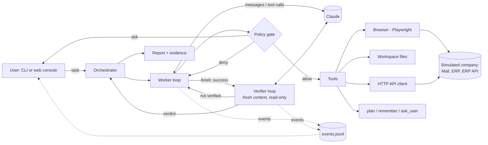

# AI Task Worker

An autonomous worker that takes a plain-language business task, such as *"Find the latest invoice from Acme Cloud, extract the amount and due date, enter it into our internal system, and tell me once it is done"*, and completes it by using a real browser, files and APIs against a simulated company. It plans, acts, watches what happens, recovers from failures, asks a human when it should, and has its result checked by an independent verifier. It then reports back with evidence.

The scope is deliberately narrow and the work is real. The company is simulated, but the worker drives an actual Chromium browser against an actual web app, downloads and parses actual PDFs, signs in with a session that can expire, and hits real validation errors and real (injected) server failures. Nothing on the worker's side is mocked except, in the automated tests, the model.

---

## Quick start

Requirements: Python 3.10+ and an Anthropic API key.

```bash
python -m venv .venv
# Windows: .venv\Scripts\activate    macOS/Linux: source .venv/bin/activate
pip install -r requirements.txt
python -m playwright install chromium
cp .env.example .env          # then set ANTHROPIC_API_KEY in .env
```

Start the simulated company (terminal 1):

```bash
python -m mock_env            # http://127.0.0.1:8700  (intranet, mail, ERP, API)
```

Then use either interface (terminal 2):

```bash
python -m worker console      # web console at http://127.0.0.1:8800 (recommended for demos)
```

```bash
python -m worker run --task-id invoice-to-erp --headed      # CLI, with a visible browser
python -m worker run "Enter the Globex invoice into the ERP."
python -m worker tasks                                       # list the example tasks
```

In the console you pick an **approval mode** and an **environment scenario** (normal, *flaky save*: the ERP commits the bill but returns a 502, or *session expires mid-task*). You then watch the plan, the actions, live screenshots, working memory and the verification verdict. Questions and approval requests appear as dialogs. Every run writes `runs/<timestamp>-<task>/` containing `events.jsonl`, screenshots, and `report.html` / `report.md`.

Run the tests (no API key needed):

```bash
pytest -q
```

### Demo

> **Demo video:** _add link here_

A suggested 3-minute walkthrough using the console:

1. **The brief's example, with failures switched on.** Click *Invoice -> ERP*, set the scenario to *Flaky save*, and press Run. The worker should pick the newest Acme invoice over the older one, the reminder and the marketing email. It downloads and reads the PDF, looks up the category in the workspace CSV, and signs in with a secret reference. If it types the amount with a separator, the ERP rejects it and it corrects the field. When the save returns a 502, the right move is to check the bill list rather than resubmit. Finally the verifier re-checks the record through the API. Open the evidence report at the end.
2. **Session expiry.** Run the same task with *Session expires mid-task*; it signs in again and carries on.
3. **Ambiguity.** *Ambiguous vendor name* ("the Globex invoice") involves two Globex vendors, so the worker either resolves it from evidence or asks you.
4. **Human in the loop.** *Outbound email*: the worker drafts the email, and the Send click stops for your approval with the exact contents shown. Decline it and see it stop as `blocked`.
5. **Different task, same code.** *Clear the AP backlog* or *Produce a file*.

---

## What it does, mapped to the brief

| Capability asked for | How it's implemented |
|---|---|
| Understand the end goal | The worker prompt asks it to define "done" before acting. The task is free text, and the worker is never given steps. |
| Break the request into actions | `update_plan` keeps an explicit, revisable plan, shown live in the console and kept in the report. |
| Use tools | A Playwright browser, sandboxed workspace files (PDF to text), an HTTP/JSON client, plus `remember`, `ask_user` and `finish`. |
| Observe each result | Every browser action returns the new page state in the same call. HTTP status, downloads and errors are surfaced explicitly. |
| Decide next step from what happened | A model-driven loop: Claude chooses each next action from the observed state. |
| Remember discovered information | `remember(key, value, source)` builds working memory with provenance. The verifier and the report receive it. |
| Detect failure | Tool errors, HTTP 4xx/5xx, validation banners, stale element refs and blocked actions are all reported back to the model as observations. |
| Retry / alternative | The harness auto-retries only idempotent operations (navigation, GET). For everything else the model must check state first. The ERP's UI and its API offer alternate routes. |
| Verify the outcome | The worker self-checks, then an **independent verifier agent** with a fresh context and read-only permissions re-checks the claims against live systems. A failed verdict sends the worker into a repair round. |
| Ask for clarification / approval | `ask_user` handles ambiguity. A **policy gate** requires human approval for irreversible or outbound actions, whatever the model wants. |
| Summary + evidence | `finish` returns a summary, result values, and claims with sources. The HTML report adds the verification checks, plan, memory, the full action trace and screenshots. |

---

## Architecture



| Module | Responsibility |
|---|---|
| `worker/agent.py` | The observe-decide-act loop, shared by worker and verifier. It validates every tool call, risk-classifies it, applies the approval gate, scrubs secrets from results, and runs the guards (repetition, error streaks, step budget, "stopped without finishing"). |
| `worker/orchestrator.py` | Runs worker, then verifier, then an optional repair round. Maps outcomes to a final status and writes the report. |
| `worker/tools/browser.py` | Page-to-text snapshot with element refs, actions by ref, download capture, screenshots, host allowlist, and dynamic risk classification from DOM facts. |
| `worker/tools/{files,http,control}.py` | Workspace files (PDF parsing), allowlisted HTTP, and the plan / memory / ask / finish / verdict tools. |
| `worker/policy.py` | `Risk` (read / write / external), approval modes, and generic classifiers for UI controls and HTTP methods. |
| `worker/secrets.py` | `{{secret:NAME}}` references, resolved at execution time and masked in all outputs. |
| `worker/llm.py` | Anthropic SDK wrapper (streaming, adaptive thinking, prompt caching, refusal fallback, typed error handling) plus `ScriptedLLM` for tests. |
| `worker/events.py`, `worker/report.py` | Structured event log, which is the single source for the CLI, the console and the report. |
| `console/` | FastAPI + SSE web console. Runs execute in background threads, and approvals and questions flow back through a queue. |
| `mock_env/` | The simulated company "Northwind Traders": webmail with PDF invoices, an AP/ERP web app with login and validation, a JSON API, and fault injection. |
| `environment.json` | The *environment profile*: which apps exist, their URLs, allowed hosts, and secret names. This is the only thing that describes Northwind to the worker. |

### One step of the loop

1. Claude receives the transcript and returns reasoning and one or more tool calls.
2. For each call, the harness validates the arguments against the tool's schema and asks the tool to **classify this specific invocation**. Clicking "Save bill" in a POST form is `write`, clicking "Send" is `external`, following a link is `read`.
3. The policy maps (risk, mode) to allow, ask or deny. *Ask* blocks on the human, and a decline goes back to the model as a result it must respect.
4. The tool runs. Browser actions wait for the page to settle, collect any downloads, note the HTTP status, re-snapshot the page and save a screenshot as evidence.
5. The result, with secrets masked, plus any guard notices goes back to Claude. Everything is emitted as events.
6. The loop ends when the model calls `finish` (worker) or `submit_verdict` (verifier), or a guard stops it.

---

## Key design decisions

**1. A narrow but real environment rather than a broad, mocked one.** The brief rewards a prototype that genuinely works. The Northwind app is small, but it has the properties that make real back-office work hard: information spread across systems (inbox, PDF, reference CSV, ERP), authentication, strict input formats (dates as DD/MM/YYYY, no thousands separators), duplicate detection, distractors (an older Acme invoice that is already entered, a payment reminder, a marketing email), and an ambiguous vendor name (two "Globex" companies). Fault injection makes the hard paths reproducible.

**2. The browser is observed as text with element refs, not raw HTML or pixels.** The snapshot renders the page in reading order, with each control tagged: `[e7 textbox "Due date" value="" placeholder="dd/mm/yyyy"]`, tables as rows, alerts marked `[alert]`. This works on any reasonably semantic web app without per-site code, costs a fraction of the tokens of HTML or screenshots, and makes actions unambiguous. Screenshots are still captured after every action as human-facing evidence, and the model can request one (`browser_screenshot`) when layout matters. Pixel-based computer use would generalise to non-web apps; that is in "next steps".

**3. Act and observe in one round trip.** Every mutating browser action returns the resulting page. This halves the number of model turns and, more importantly, means the model always reasons from the real outcome, never from its expectation.

**4. Safety lives in a policy gate, not in the prompt.** Tools only report *how risky this particular call is*, using generic facts: is it a submit control in a POST form, does its label say send / pay / delete / approve, which HTTP method is it. One policy decides allow, ask or deny per mode (`guarded`, `strict`, `autonomous`, `read_only`). The same tools serve the verifier under `read_only`, so the verifier *cannot* change state, by construction. Approval prompts show the human exactly what will happen, including the form contents being submitted.

**5. Credentials are references, never values.** The model types `{{secret:erp_password}}`. The harness substitutes the value at execution time, and the value is masked out of every tool result, event and report. Password fields render as `********` in snapshots.

**6. Retries are split by idempotency.** The harness silently retries navigation and GET requests on transient errors, which wastes no model turns. It **never** auto-retries anything that creates or sends data. After a 5xx the model is told explicitly that the outcome is unknown and that it must check state before repeating. The *flaky save* scenario exists to test exactly this: the bill is committed but the user sees a 502, and a naive retry creates a duplicate.

**7. Verification by a second agent that didn't do the work.** Agents are prone to convincing themselves they succeeded. After the worker calls `finish(success)`, a verifier with a fresh context, an adversarial brief, read-only permissions, and access to the original task (not just the worker's story) re-derives what must be true and checks primary sources: the ERP record or API, and the source document. If it isn't verified, its failed checks go back to the worker for a bounded repair round. The final status distinguishes `completed_verified` from `completed_unverified`, so "done" carries a confidence level.

**8. Guards for the ways agents go wrong.** Identical repeated calls get a "change approach" notice. Three consecutive tool failures prompt it to step back and replan, and seven abort the run. A step budget triggers a wrap-up warning near the end. Ending a turn without calling a tool is nudged twice, then treated as no progress. Every abnormal end still produces an honest status and a report.

**9. Generalisation through configuration.** Nothing in `worker/` knows about invoices, Northwind or ERPs. The task arrives as free text, the environment arrives as a JSON profile, and tools are generic. The five example tasks in `tasks.json` (invoice entry, ambiguous request, backlog reconciliation, outbound email, CSV report) all run on unchanged code. Pointing the worker at a different set of web apps means writing a new `environment.json`.

**10. One event log feeds everything.** CLI output, the live console, the HTML/Markdown report and the tests all consume the same structured events. This made debugging straightforward (`events.jsonl` is a complete replay of what the model saw and did) and keeps the UIs thin.

**11. Model choices.** The worker defaults to Claude Opus 5 (`claude-opus-5`, override with `WORKER_MODEL`). It uses adaptive thinking with summarised reasoning, which the console displays, `effort: high` for agentic reliability, streaming, and automatic prompt caching of the growing transcript. Server-side refusal fallback is enabled when the account supports it and is switched off automatically if not. The system prompts are static per run so the cache prefix stays stable; the date and task go in the first message. The prompts state principles (observe before acting, check before repeating writes, verify against the system of record) rather than scripting steps.

---

## How failures are handled

| Situation | What happens |
|---|---|
| Form validation error (e.g. `4,812.50`) | The page re-renders with an `[alert]`. The result says the request was rejected (HTTP 422), and the model reads the reason and corrects the field. |
| Server 502 after a submit | The result carries an "outcome unknown, check state before retrying" warning. The model searches the bill list, finds the committed bill, and doesn't resubmit. |
| Session expires | The ERP redirects to sign-in with a "session expired" alert. The model signs in again and is returned to the page it was on. |
| Duplicate entry attempt | The ERP rejects it and names the existing bill, which tells the model it was already done. |
| Stale element ref | A clear error says to use refs from the latest page state. |
| Navigation to a non-allowlisted host | Blocked by policy, with the reason returned to the model. |
| Human declines an approval | The model is told not to retry, and finishes as `blocked` or finds another route. |
| Model claims success incorrectly | The verifier reports `not_verified` with failed checks, and the worker gets a repair round (max 2 verification rounds). |
| Looping / error spiral / out of steps | Guard notices first, then a hard stop with status `failed` and a report. |
| Missing API key, API down, refusal | Typed SDK errors become a clean `failed` result with an explanation. Nothing crashes the run silently. |

---

## Testing

`pytest -q` runs 15 tests in about 20 s with no API key. The integration tests use the **real harness, real Chromium and the real mock app**; only the model is replaced, by a scripted policy (`ScriptedLLM`) that reads the same tool results Claude would see. They cover:

- the full invoice flow, with a deliberate validation error and an ambiguous 502, ending with exactly one bill, matching fields, no secret values in the trace, screenshots, and a verified report
- the verifier being unable to write: its POST is refused by the policy gate
- outbound email requiring approval, with the approval prompt showing the form contents, and a decline leaving nothing sent
- a failed verification triggering a repair through the ERP API
- step budget and repetition guards
- snapshot rendering (password masking) and host allowlisting

Unit tests cover risk classification, policy modes, secret resolution and masking, argument validation, the guard, and the evaluation's own scoring functions.

These tests prove the plumbing, not model judgment. The live evaluation below measures model judgment.

## Live evaluation

`python -m evals.run` runs every example task, plus the failure scenarios, against the real model. It then scores each run from the simulated company's **actual state** (via `/_admin/state`), not from what the worker says it did:

| Case | What must be true afterwards |
|---|---|
| `invoice/normal` | Exactly one bill for ACME-2026-0917 with the right vendor, amount, currency, dates and category; final status `completed_verified` |
| `invoice/flaky-save` | Same, although the save returns a 502 after committing, so a blind retry would create a duplicate |
| `invoice/session-timeout` | Same, although the ERP session expires mid-task |
| `ambiguous-vendor` | Either it asked which Globex was meant, or it entered GX-55120 correctly (GL-7781 is already entered); no duplicates |
| `backlog` | The three missing bills are each entered exactly once with correct fields; no duplicates of existing ones |
| `email/approved` | One email to Globex Logistics mentioning GL-7781 and its due date (14 Oct 2026), sent only after an approval request |
| `email/declined` | Nothing sent, and the run does not claim success |
| `report-file` | A CSV in the workspace containing the open bill and excluding the paid one |

Options: `--repeat N` for success rates, `--only <substring>` to run a subset. Results go to [`evals/results.md`](evals/results.md) and `evals/results.json`, and each run's full trace stays in `runs/`.

## Recording the demo

`python -m demo.record` starts the mock environment and the console, then drives the console in a Playwright browser with video recording on. It runs the invoice task under the *flaky save* fault and the approval-gated email task, approves through the UI, and opens the evidence report. Output: `docs/demo.webm`, `docs/console.png` and `docs/report.png`. The recording is the real console during real runs; the only addition is a caption naming the scenario.

---

## Known limitations

- **Web apps only.** There is no desktop or pixel-level computer use. Pages that rely on canvas or custom widgets without semantic HTML would be hard to operate from the text snapshot.
- **One simulated company.** The worker code is generic, but it has only been exercised against Northwind. Real sites bring CAPTCHAs, MFA, iframes, shadow DOM and heavy client-side rendering, none of which are handled specially.
- **Risk classification is heuristic.** It uses form method and control labels. It is conservative ("Cancel" is treated as external) and could miss an irreversible action behind an innocuous label. A production system would let app owners annotate actions.
- **The context grows linearly.** Long tasks keep every snapshot in the transcript, which is fine for the tens of steps here. Very long tasks would need context editing or summarisation.
- **No persistence across runs.** Working memory is per run, and runs cannot be resumed after a crash.
- **The verifier shares the worker's model and browser session.** A different model, or a separately authenticated session, would make verification more independent.
- **A small evaluation set.** The live evaluation has 8 cases in one environment. That catches regressions and obvious failures, but it isn't a statistically strong measure of reliability.
- **Single user, local only.** The console has no authentication.

## What I would build next

1. **A bigger evaluation:** more tasks, a second simulated environment with different apps to test generalisation properly, many repeats per case, and sweeps over model, effort level and prompt version, tracking success rate, cost and steps.
2. **A computer-use fallback** for non-semantic UIs and desktop apps, using screenshots plus mouse and keyboard when the text snapshot is insufficient.
3. **Action annotations in the environment profile** (e.g. "POST /erp/bills is a financial write; bills > $10k require CFO approval"), so business rules from documents like the CFO's email become enforced policy, not just model knowledge.
4. **Durable runs:** checkpoint the transcript and state so a run can pause for approval for hours and then resume, and keep cross-run memory of learned procedures (e.g. "the ERP wants DD/MM/YYYY").
5. **Context management** for long tasks: clear stale snapshots and summarise completed sub-goals.
6. **Parallel sub-agents** for fan-out tasks (e.g. reconciling 50 invoices), coordinated by the orchestrator.
7. **Stronger independence for verification:** a different model, a separate credential, and checks generated from the task before the worker starts.

## Assumptions

- The worker operates on behalf of an AP team member who may enter bills into the ERP. Internal record creation that the task explicitly asks for is permitted without confirmation. Anything outbound or irreversible (sending email, paying, deleting) needs approval in the default mode.
- "Latest invoice" means the most recent invoice document from that vendor, not reminders or marketing emails. Bills are recorded in the invoice's currency, and the category comes from the AP team's reference file.
- The worker knows which company apps exist and their URLs (via the profile), like an employee with bookmarks. It is not told how to use them.
- Credentials are test values for the simulated app, stored in `.env`, and never shown to the model.

## Models, APIs and components used

- **Claude Opus 5** via the **Anthropic Python SDK** (`anthropic` 1.x): Messages API with tool use, adaptive thinking, streaming, prompt caching, and server-side refusal fallback (beta).
- **Playwright** (Chromium) for browser automation.
- **FastAPI**, **Uvicorn**, **Jinja2** for the simulated company and the web console. **Server-Sent Events** carry live updates.
- **pypdf** to extract PDF text, **fpdf2** to generate invoice PDFs, **httpx** for HTTP calls, **python-dotenv** for configuration, **pytest** for tests.
- No agent framework. The loop, policy, verification and guards are implemented directly (the worker package is about 2.2k lines) so every behavior is visible and testable.
- Built with AI coding assistance (Claude Code).

## Project layout

```
worker/            agent loop, orchestrator, policy, secrets, LLM wrapper, report, CLI
  tools/           browser, files, http, control (plan/remember/ask/finish/verdict)
console/           web console (FastAPI + SSE) and its single-page UI
mock_env/          simulated company: mail, ERP, API, PDF invoices, fault injection
environment.json   environment profile (apps, allowed hosts, secret names)
workspace/         the worker's file sandbox (reference CSV; downloads land here)
tasks.json         example tasks
tests/             unit + end-to-end tests (scripted model, real browser and app)
evals/             live evaluation: tasks x failure scenarios, scored from environment state
demo/              records the demo video by driving the console
```
